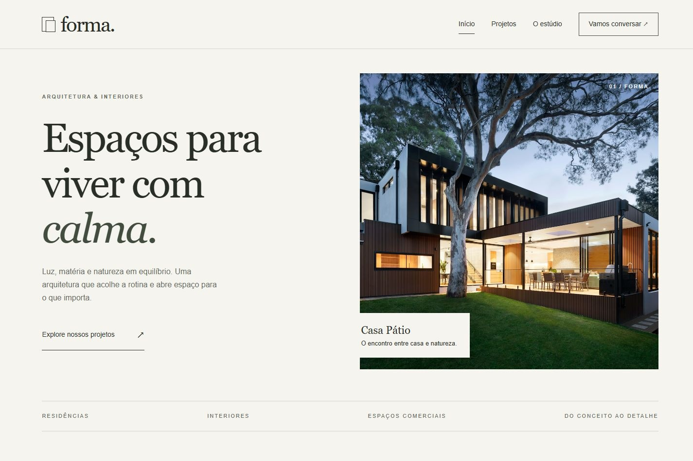

# Forma Arquitetura

Este é um projeto meu para o meu **portfólio de apresentação**. Criei o site de um escritório fictício de arquitetura para praticar **HTML, CSS e JavaScript**, com atenção ao visual e à navegação no computador e no celular.

**[Abrir o site](https://felipe-landgraf.github.io/forma-arquitetura/)** · [Baixar o projeto](https://github.com/Felipe-Landgraf/forma-arquitetura/archive/refs/heads/main.zip)

## O que tem no site

- Páginas de início, projetos, estúdio e contato.
- Galeria com filtros e detalhes dos projetos.
- Menu para celular, perguntas frequentes e formulário com validação.

## Como abrir

Acesse o link acima ou baixe o projeto, extraia a pasta e abra `index.html`. No VS Code, escolha **Abrir site no Chrome** ou **Abrir site no Edge** em **Run and Debug** e aperte **F5**.

O escritório e os projetos de arquitetura são fictícios. O formulário é uma demonstração e não envia mensagens. As fotos são ilustrativas; os créditos estão em [CREDITOS.md](CREDITOS.md).

---

**Felipe Landgraf** · Estudante de Desenvolvimento de Sistemas no **COTIL–Unicamp**.
